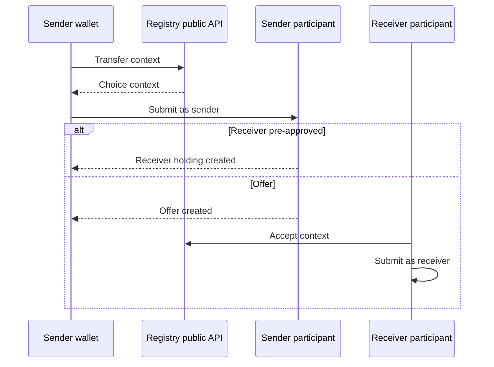

Day to day you do three things. You mint, burn, pause, and freeze through Token App. Holders transfer through their wallets and the public Registry.

A party you control authorizes each admin operation. Token App fetches the choice context from the Registry with its M2M credential, then submits on your participant. A holder's wallet fetches a public context and submits on the holder's participant. The Registry does not submit either one.

## Issuance

Mint to the treasury under its mint delegation, then transfer to holders. That keeps a single place where supply enters your books.

A batch mint requires a mint delegation for every recipient. A single mint to another party needs that party's mint delegation, or that party's signature on the mint. A single mint to your own party is already authorized by the party that submits it, because that party is both the issuer and the recipient. A holder who receives a transfer needs neither.

Burn the other way: the holder transfers to the treasury (immediately, if the treasury pre-approved incoming transfers), and you burn from the treasury. You can also burn a holder's balance directly. That burn is an issuer action. It is refused while the instrument is paused or the party is frozen. The compliance burn, which is available in those states, is a different action. [Compliance](/token-factory/compliance).

Amounts use the instrument's decimals. An amount with more precision than the instrument allows is rejected.

<Info>
Send a new `command_id` for each mint or burn. Reuse the same `command_id` only to retry a call whose result you did not see. The ledger treats that id as the same command, so the retry does not create a second mint.
</Info>

### Token App operator API

Token App listens on port 8002 inside your network. Every route below, except health and metrics, requires:

```http
Authorization: Bearer <token>
```

The token is issued by your identity provider for the Token App audience. OpenAPI for these routes is served at `/docs` on the same service.

<CodeGroup>

```bash Mint request
curl -sS -X POST "$BASE/api/admin/mint" \
  -H "Authorization: Bearer $TOKEN" \
  -H "Content-Type: application/json" \
  -d '{
    "command_id": "mint-2026-01-01-001",
    "instrument_id": "TOKEN",
    "party_id": "<treasury-party>",
    "amount": "100.0"
  }'
```

```json Response
{ "command_id": "mint-2026-01-01-001", "status": "submitted" }
```

</CodeGroup>

| Method and path                         | Purpose                                                                                               |
| --------------------------------------- | ----------------------------------------------------------------------------------------------------- |
| `POST /api/admin/mint`                  | Mint to one party. Body: `command_id`, `instrument_id`, `party_id`, `amount`                          |
| `POST /api/admin/burn`                  | Burn from one party. Same body                                                                        |
| `POST /api/admin/mint-batch`            | Mint to many parties in one transaction. One rejection fails the batch                                |
| `POST /api/admin/burn-batch`            | Burn from many parties in one transaction                                                             |
| `POST /api/admin/multi-mint-batch`      | Mint across several of your instruments in one transaction                                            |
| `POST /api/admin/multi-burn-batch`      | Burn across several instruments                                                                       |
| `POST /api/admin/multi-mint-burn-batch` | Mint and burn across instruments in one transaction                                                   |
| `GET /data/admin/mints`                 | Confirmed mints. Filters: `party_id`, `instrument_id`. Pages: `limit` (1–1000, default 100), `offset` |
| `GET /data/admin/burns`                 | Confirmed burns. Same filters                                                                         |
| `GET /data/admin/holdings`              | Latest holdings scan. Same filters. `limit` default is large; page it                                 |
| `GET /status`                           | Cached supply, holders, and monitor health. No live ledger read                                       |
| `GET /healthz`                          | Liveness. No credential                                                                               |
| `GET /metrics`                          | Prometheus. No credential                                                                             |

A mint or burn record:

| Field           | Meaning                                       |
| --------------- | --------------------------------------------- |
| `command_id`    | The id you sent                               |
| `created_at`    | When Token App recorded the confirmation      |
| `party_id`      | Recipient of a mint, or the party burned from |
| `instrument_id` | Instrument                                    |
| `update_id`     | Ledger update                                 |
| `amount`        | Decimal string                                |

A holding:

| Field           | Meaning                                                                |
| --------------- | ---------------------------------------------------------------------- |
| `holding_cid`   | Ledger contract id                                                     |
| `party_id`      | Owner                                                                  |
| `instrument_id` | Instrument                                                             |
| `amount`        | Decimal string                                                         |
| `locked`        | True while a live lock, such as an in-flight transfer, blocks spending |

`/status` is the monitor's last cycle. Per instrument it reports `total_supply` (spendable plus locked), `total_locked_supply`, `unique_holders`, `top_holder_share` (0 to 1), and `supply_concentration_hhi` (1.0 when one holder has the whole supply). `operational.monitor` reports the last success, its age, and the poll interval. An empty `tokens` object means monitoring is off. The field list and the reward fields are in [Observability](/token-factory/observability) and [Rewards](/token-factory/rewards).

Batch calls take `command_id`, `instrument_id`, and `entries` of `{ "party_id", "amount" }`. The response adds `entry_count`. A batch is one ledger transaction.

## Transfers

A wallet integrates an instrument the way it integrates any other Canton token-standard asset.

1. List instruments from the Registry metadata API.
2. Ask the Registry for a transfer choice context.
3. Submit that context on the holder's participant, as the holder.
4. If the receiver has pre-approved incoming transfers, the transfer completes in that submission and the receiver's holding is created.
5. Otherwise the sender's submission creates an offer. The receiver fetches an accept or reject context and submits it. The sender can withdraw the offer after the deadline they set on it.



The Registry base URL and the organization prefix are what Cantor8 publishes at launch. Routes:

| Method and path                                                                    | Purpose                                                                 |
| ---------------------------------------------------------------------------------- | ----------------------------------------------------------------------- |
| `GET /api/{prefix}/registry/metadata/v1/info`                                      | Registry identity                                                       |
| `GET /api/{prefix}/registry/metadata/v1/instruments`                               | Instruments this Registry serves                                        |
| `GET /api/{prefix}/registry/metadata/v1/instruments/{id}`                          | One instrument                                                          |
| `POST /api/{prefix}/registry/transfer-instruction/v1/transfer-factory`             | Prepare a transfer. v2 is the same surface at `.../v2/transfer-factory` |
| `POST /api/{prefix}/registry/transfer-instruction/v1/{id}/choice-contexts/accept`  | Receiver accepts an offer. Also `reject` and `withdraw`                 |
| `POST /api/{prefix}/registry/allocation-instruction/v1/allocation-factory`         | Prepare an allocation. v2 alongside                                     |
| `POST /api/{prefix}/registry/allocations/v1/{id}/choice-contexts/execute-transfer` | Settle. Also `withdraw` and `cancel`                                    |

These routes are public. The live request and response shapes are the OpenAPI document at `/api-docs` on the Registry.

A transfer is refused while the instrument is paused, while the instrument is marked non-transferable, or while either party is frozen. The check runs when the action executes, so a freeze applied after the offer was created still stops the accept.

## Settlement

An allocation locks the sender's holdings for a settlement: delivery versus payment, a swap, or any exchange where neither side wants to move first.

| Step     | Who                                                    | Result                                                      |
| -------- | ------------------------------------------------------ | ----------------------------------------------------------- |
| Allocate | Sender, via the Registry allocation context            | Holdings lock. A proposal exists                            |
| Accept   | Receiver                                               | The settlement can be executed                              |
| Execute  | The executor named on the allocation                   | Locked holdings move to the receiver                        |
| Cancel   | The executor, with the parties the settlement requires | Locked holdings return toward the sender, subject to freeze |
| Withdraw | Sender, after the deadline                             | The sender takes the locked amount back, subject to freeze  |

The executor is the party the sender named to complete or cancel. It can be one of the two sides or a third party.

While the sender is frozen, the locked amount stays locked. The sender cannot withdraw it, and a cancel that would return it to the sender is refused. The validator proposes a seizure, and Token App submits the admin's approval. [Compliance](/token-factory/compliance).

## Several instruments

One factory and one Token App serve every instrument of the same admin. A new instrument is an agreed record, a signed addition, a listing Cantor8 adds on the Registry, and one more entry in Token App's `config.instruments`. The same mint API takes the new `instrument_id`.

Retiring an instrument pauses it first. The ticker stays reserved for that admin and drops out of the active public list.
